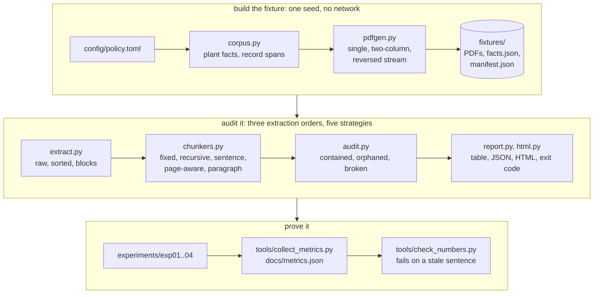
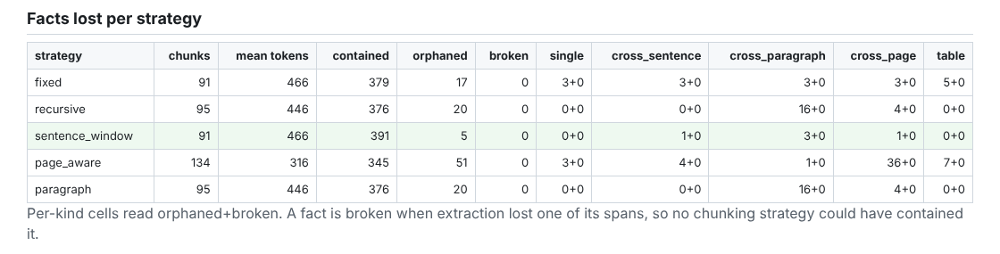

# chunk-boundary-auditor

**Plants facts in seeded PDFs, chunks them five ways, and counts the facts that end up in no chunk at all: a boundary loss the chunker's own output cannot show you, measured before any embedding model gets the blame.**

[](https://github.com/KeerthiGanuthala/chunk-boundary-auditor/actions/workflows/ci.yml)


## What a chunker's output cannot tell you

A chunker's output cannot show which facts it split across a boundary, because the fact exists in the document and in no chunk. You can read every chunk and never find the gap. Four questions this repository answers that reading the chunks does not:

1. How many facts of each shape (one sentence, two sentences, across a paragraph, across a page, in a table) does a strategy leave with no chunk that holds all of their text?
2. How many facts were already gone when the PDF extractor handed over the text, before any chunker ran, and which page layout lost them?
3. What does overlap actually recover, and how many more chunks does the index carry for it?
4. When a chunker promises never to cut inside a sentence, does extracted PDF text let it keep that promise?

## The numbers that are not flattering

- **The usual fix for extraction, `sort=True`, breaks 122 of the 396 planted facts (30.8 percent of every fact in the fixture) before any chunker runs.** Every one of them is on a two-column page, where position-sorted extraction interleaves the columns line by line; of the 198 facts on two-column pages, that is 61.6 percent of the facts on two-column pages. Block clustering breaks 0 of the same facts.
- **Giving the recursive splitter 32 tokens of overlap loses 1 more fact than no overlap at all, and 64 tokens loses 4 more.** The carried pieces take room in the next chunk and push apart a paragraph pair that used to fit. It reaches zero at 256 tokens of overlap, half the chunk.
- **The best strategy still orphans 5 facts at the policy size of 512 tokens.** Fixed windows, the tutorial default, lose 17 facts (4.3 percent of planted facts); the recursive splitter loses 20; page-aware windows lose 51, because all 36 cross-page facts are unreachable to it by construction.

264 tests, 99 percent line coverage, 4 experiments, 5 decision records, 18 PDFs with 396 planted facts. Every figure in this document is re-measured by CI and checked against the prose by `tools/check_numbers.py`; a stale sentence fails the build.

## Quickstart

Prerequisites: Python 3.10 or newer, `make`. No network is used at runtime; the fixture is committed.

```bash
git clone https://github.com/KeerthiGanuthala/chunk-boundary-auditor.git
cd chunk-boundary-auditor
python -m pip install -e ".[dev]"

# the headline table: five strategies at the policy size, on the recommended extraction order
chunkaudit audit

# the same table on the extraction order most tutorials recommend; exits 1 with the reason
chunkaudit audit --mode sorted

# where one fact's spans landed, span by span
chunkaudit explain D06-single-1 --strategy sentence_window

# lint, tests, fixture check, experiments, receipts
make verify
```

## Extraction loses facts before the chunker can

The audit's first finding is that the chunker is not the first thing to lose a fact. The fixture's 18 documents include 9 two-column documents, and 4 of those write the right column into the PDF content stream before the left one, which some producers do and which no page image reveals. PyMuPDF offers 3 orders to read a page in. On each, the best chunking strategy at 512 tokens:

<!-- table:exp04 -->
| extraction order | what it is | facts broken before chunking | facts orphaned by the chunker |
| --- | --- | --- | --- |
| `raw` | content stream order, the library default | 0 | 13, of which 9 on the reversed-stream documents |
| `sorted` | `sort=True`, the fix most tutorials recommend | 122 | 10, of which 5 on the reversed-stream documents |
| `blocks` | text blocks clustered into columns by horizontal position | 0 | 5, of which 0 on the reversed-stream documents |
<!-- /table -->

A broken fact has a span that no longer exists as a contiguous sentence anywhere in the extracted text, so no chunking strategy could ever contain it. `sorted` orders lines by position across both columns, and every sentence that wraps gets another column's line spliced into it. `raw` keeps every sentence intact and scrambles the paragraph order on the reversed-stream documents, which costs 9 orphans on them that the block order does not pay. The block order costs one extra sort per page.

Source: `experiments/exp04_extraction_loss.py`, JSON in `docs/experiments/exp04_extraction_loss.json`.

## Five strategies at the policy size

Every strategy is reimplemented in this repository in a few dozen lines (ADR-002 says why), run at 512 tokens with no overlap on the block extraction order. Sizes are in the repository's own deterministic tokens (ADR-003), comparable with each other and with nothing else.

<!-- table:exp03 -->
| strategy | chunks | orphaned | single | cross-sentence | cross-paragraph | cross-page | table |
| --- | --- | --- | --- | --- | --- | --- | --- |
| sentence packing | 91 | **5** | 0 | 1 | 3 | 1 | 0 |
| fixed windows | 91 | 17 | 3 | 3 | 3 | 3 | 5 |
| recursive (paragraph, line, sentence, word) | 95 | 20 | 0 | 0 | 16 | 4 | 0 |
| paragraph packing | 95 | 20 | 0 | 0 | 16 | 4 | 0 |
| page-aware fixed windows | 134 | 51 | 3 | 4 | 1 | 36 | 7 |
<!-- /table -->

Three things the per-kind columns say that the total does not. Fixed windows are the only strategy that loses single-sentence facts, because a token window cuts wherever the count runs out, including inside a word. The recursive splitter and paragraph packing lose exactly the same facts at this size, because at 512 tokens every paragraph fits and the recursive separators below paragraph level never fire: the recursive splitter degenerates into paragraph packing, and its losses are all cross-paragraph pairs that a paragraph-respecting boundary separates by definition. Page-aware chunking loses every cross-page fact, which is the point of including it: a strategy that cannot cross a page cannot hold a fact that does, and the audit counts that as a loss rather than a feature.

Source: `experiments/exp03_strategy_compare.py`.

## The loss is mostly a property of size

The same five strategies at six sizes. Orphaned facts out of 396:

<!-- table:exp01 -->
| size (tokens) | fixed | recursive | sentence packing | page-aware | paragraph |
| --- | --- | --- | --- | --- | --- |
| 128 | 76 | 113 | 18 | 92 | 109 |
| 256 | 41 | 59 | 14 | 64 | 59 |
| 384 | 16 | 26 | 7 | 45 | 26 |
| 512 | 17 | 20 | 5 | 51 | 20 |
| 768 | 8 | 8 | 2 | 36 | 8 |
| 1024 | 10 | 9 | 1 | 36 | 9 |
<!-- /table -->

Fixed windows lose 76 facts at 128 tokens, which is 19.2 percent of planted facts, and sentence packing orphans 18 at 128 tokens. At the far end sentence packing is down to 1 fact at 1024 tokens while page-aware is pinned at the 36 cross-page facts it can never hold. The size column, not the strategy column, is where most of the loss lives; the strategy decides which kind of fact pays for it.

Source: `experiments/exp01_size_sweep.py`.

## Overlap, priced

Overlap is the standard answer to a boundary loss and is nearly always quoted without its cost. Both strategies that take a token overlap, at 512 tokens:

<!-- table:exp02 -->
| strategy | overlap | chunks | growth | orphaned | recovered |
| --- | --- | --- | --- | --- | --- |
| fixed | 0 | 91 | 1.0 | 17 | 0 |
| fixed | 32 | 93 | 1.02 | 1 | 16 |
| fixed | 64 | 103 | 1.13 | 0 | 17 |
| fixed | 128 | 110 | 1.21 | 0 | 17 |
| fixed | 256 | 156 | 1.71 | 0 | 17 |
| recursive | 0 | 95 | 1.0 | 20 | 0 |
| recursive | 32 | 96 | 1.01 | 21 | -1 |
| recursive | 64 | 100 | 1.05 | 24 | -4 |
| recursive | 128 | 115 | 1.21 | 4 | 16 |
| recursive | 256 | 153 | 1.61 | 0 | 20 |
<!-- /table -->

For fixed windows, an overlap of 64 tokens recovers every orphan at 13 percent more chunks; 32 tokens already brings the loss down to 1. For the recursive splitter the sign flips first: the carried pieces are whole sentences or table lines, they occupy the head of the next chunk, and a cross-paragraph pair that used to fit at the tail no longer does. The recursive splitter reaches zero at 256 tokens of overlap, with the index 61 percent larger. ADR-005 records why overlap is published as cost against benefit and never as a recommendation.

Source: `experiments/exp02_overlap_sweep.py`.

## The bugs the measurement found

**A one-sentence fact orphaned by the strategy that never cuts a sentence.** Sentence packing orphaned fact D06-single-1, a single sentence. In the extracted text the sentence read `... USD. The` newline `Tovqua M3 unit has a nominal voltage of 684 V.` and the splitter took every newline as a sentence end, so `The` closed one unit and the rest opened another. Extracted PDF text has a newline at every line wrap, so this was every sentence that happened to wrap at a chunk boundary, not a corner case. A lone newline is now whitespace for that strategy and only a blank line separates units; the price, that a table block becomes one unit, is pinned by a test. The recursive strategy deliberately keeps the single newline as a separator, because that is what the framework splitter it mirrors does on the same text (ADR-002).

**Two-column documents with an empty right column.** The first fixture filled the left column until it overflowed, and it never overflowed, because a page's worth of paragraphs fits in one column. Every "two-column" document was single-column text with a wide margin, and the sorted-order interleaving that experiment 4 exists to measure never happened. The split now balances column heights; a test asserts that every two-column page has text blocks on both sides.

**A doubled full stop from the recursive splitter.** Splitting on `. ` and re-appending the stop gave `outage..` on the last sentence of every paragraph, which changed token counts and made any fact ending a paragraph unmatchable. It showed up as a cross-paragraph orphan rate for the recursive strategy that no other strategy had.

**A table spliced into a cross-paragraph gap.** Tables were inserted at any paragraph index, so some landed in the gap a cross-paragraph fact straddles, quietly turning it into a cross-table fact that the fact's kind did not describe. The generator now records every glued gap and keeps tables out of it.

Each of these has its own commit and its own test with the story in the docstring.

## Architecture



Source, rendered by `tools/render_diagram.py` and committed so it does not depend on GitHub's renderer:



## Evidence


The verdict section of the HTML report, captured by `tools/capture_screenshots.py` from the report `chunkaudit audit --html` writes. The same tool reads back the badge's computed colours and fails if the badge is invisible, because a badge rendered green on green passed every other check in a previous project.




A replay of captured stdout, not a screen recording: `tools/record_demo.py` runs each command, records its real output, exit code and wall time, and plays it back paced by that time. `docs/video/manifest.json` lists every command with its exit code; the MP4 is at `docs/video/demo.mp4`.

## The fixture

18 PDFs, 73 pages, generated from seed `20251116` by `chunkaudit generate` and pinned by SHA-256 in `fixtures/manifest.json`. `chunkaudit generate --check` regenerates into a temporary directory and fails on any byte that differs, so a PyMuPDF upgrade that moves a line break fails loudly instead of silently moving every number. 396 planted facts: 108 single, 108 cross-sentence, 72 cross-paragraph, 36 cross-page and 72 table. The awkward cases are deliberate:

- the filler sentences carry numbers, years and units of their own, so a fact cannot be found by looking for the number;
- a cross-page fact always has a page footer between its two sentences;
- 9 of the documents are two-column, and 4 of those write the right column first in the content stream, so stream order and position order disagree on which is right;
- the second sentence of every two-sentence fact starts with a pronoun, so a chunk holding only that sentence names nothing;
- table facts need the header line and the row line, and a chunk holding one without the other is counted as a loss.

What is not in it, and therefore cannot be measured: scanned pages, hyphenation at line ends, rotated text, forms, and producers whose block structure PyMuPDF segments differently.

## What this cannot measure

Containment is a necessary condition for retrieval, not a sufficient one. A chunk that holds every span of a fact can still lose the ranking to a neighbour, and this repository never runs a retriever or an embedding model, so it says nothing about retrieval quality. It measures the loss that happens before retrieval could begin, and attributes it to the chunker or to extraction.

The corpus is synthetic. Its prose is regular, its sentences short, its facts dense. The counts here are comparable with each other and with nothing outside the fixture; the one claim that would need real documents, that a strategy losing 1.3 percent of the planted facts here loses about that much in production, is not made. ADR-001 is the boundary.

A measured zero is a zero over 396 facts, so any claim about the population these stand in for has a resolution floor of one in 396. "Block clustering broke 0 facts" means below one in 396 on this fixture, not never.

Token sizes are the repository's own (ADR-003). The recursive and sentence strategies are faithful to the shapes of their framework counterparts, not to any particular version's code.

## Layout, exit codes, reproduction

```
chunk-boundary-auditor/
  config/policy.toml        every threshold and size, with the reason beside it
  src/chunkaudit/
    corpus.py               seeded generator: documents, planted facts, required spans
    pdfgen.py               PyMuPDF rendering in the layouts that hurt
    extract.py              raw, sorted and block-clustered extraction
    tokens.py               deterministic token counting with offsets
    chunkers.py             the five strategies
    audit.py                containment: contained, orphaned, broken
    report.py, html.py      tables, JSON, HTML, exit codes
    fixture.py, pipeline.py manifest pinning; the one path the CLI and experiments share
    cli.py                  generate | audit | extract | explain
  fixtures/                 18 PDFs, facts.json, manifest.json
  experiments/              exp01 size sweep, exp02 overlap, exp03 strategies, exp04 extraction
  docs/experiments/         their JSON
  docs/adr/                 five decision records
  docs/metrics.json         every published figure, with the phrase each must be quoted in
  tools/                    collect_metrics, check_numbers, render_banner, render_diagram,
                            capture_screenshots, record_demo
  tests/                    264 tests, each named as the property it pins
```

Exit codes of `chunkaudit audit`:

| code | meaning |
| --- | --- |
| 0 | the audit ran and the policy thresholds hold for the best strategy |
| 1 | the audit ran and the answer is no: a threshold was exceeded, and the reason is printed |
| 2 | the tool could not answer: bad arguments, unreadable fixture, policy error |
| 3 | the fixture does not match its manifest, so any number would describe bytes nobody committed |

Code 1 is a finding and codes 2 and 3 are failures to find; a CI job should treat them differently. `chunkaudit audit --mode sorted` exits 1 on this fixture, by design.

Make targets: `lint`, `test`, `fixtures` (the manifest check), `audit`, `experiments`, `receipts`, `evidence`, and `verify`, which runs lint, test, fixtures, experiments and receipts in that order. `receipts` re-measures every figure into `docs/metrics.json` and then runs `tools/check_numbers.py`, which matches anchor phrases rather than bare digits: "orphans 17 facts" going stale is caught even when the digits 17 still appear somewhere in a table.

## Stack

| technology | role here | why this one |
| --- | --- | --- |
| Python 3.10 to 3.12 | everything | the CI matrix; nothing newer than 3.10 syntax is used |
| PyMuPDF | writes the fixture PDFs and reads them back | the ingestion library the audit is about; reading its own output is a risk ADR-004 defeats on purpose |
| the standard library `random` | the seed | one integer reproduces every document, fact and PDF byte on every platform |
| a regex tokenizer | token counting with offsets | no network, no download, no state (ADR-003) |
| pytest, pytest-cov, ruff | tests, coverage JSON, lint | the receipts read junit and coverage JSON, never a parsed progress line |
| Playwright and Chromium | screenshots, diagram, demo replay | the only thing in the pipeline that can see pixels, so the only thing that can catch an invisible badge |
| no LangChain, no embedding model | | the five strategies are reimplemented so the audit can say where a boundary fell and why (ADR-002) |

Decision records:

- [ADR-001: a seeded synthetic corpus with planted facts, not a public dataset](docs/adr/ADR-001-synthetic-corpus-with-planted-facts.md)
- [ADR-002: containment as the metric, and splitters reimplemented rather than imported](docs/adr/ADR-002-containment-as-the-metric.md)
- [ADR-003: token counting without a network](docs/adr/ADR-003-token-counting-without-a-network.md)
- [ADR-004: one library for generating the fixture and extracting it](docs/adr/ADR-004-one-library-for-generation-and-extraction.md)
- [ADR-005: overlap is a priced trade, published as cost against benefit](docs/adr/ADR-005-overlap-as-a-priced-trade.md)

## The pivot, and what a v2 would need

Embedding-based semantic chunking is out of scope. The trigger for adding it: an embedding model that runs offline becomes available in the toolchain, and paragraph packing is not already within a handful of facts of the best strategy at the policy size. On this fixture paragraph packing loses 20 and sentence packing loses 5, so the structure-aware strategy has room to beat, and a semantic splitter would have to beat sentence packing, not fixed windows, to earn its model.

Future work, in the order it would change the numbers:

- Plant facts in a user's own PDFs: the corpus module already records spans per fact, so a small annotation format over real documents would turn the fixture boundary in ADR-001 into a measurement.
- Hyphenation and scanned pages in the fixture, which are the two extraction losses this fixture cannot see.
- A real BPE tokenizer behind an optional extra, with the sweep re-run so the two token scales can be compared on the same fixture.
- Neighbourhood retrieval as a strategy, so "the retriever fetches adjacent chunks" can be audited as the unit it actually is.
- The first metric to watch after any of these: the cross-paragraph orphan count for the recursive splitter, because it is the one that moved in the wrong direction under overlap.
